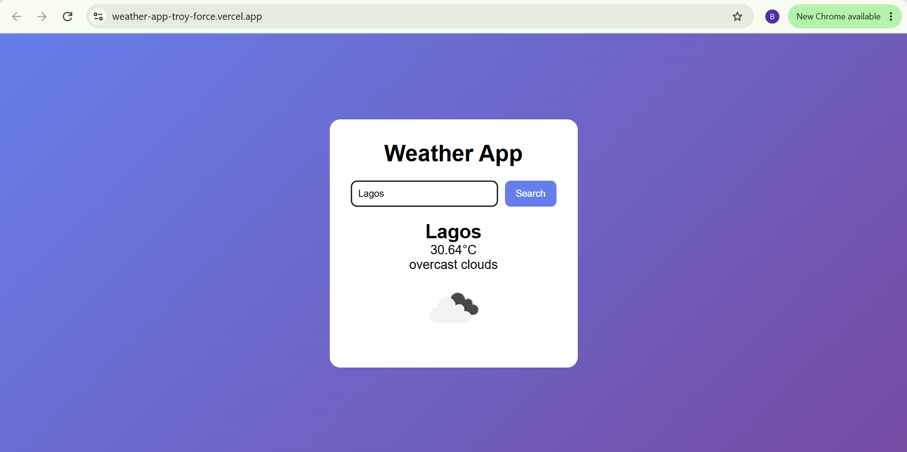

# Weather App 🌤️

A simple weather app that fetches real-time weather data for any city in the world.

## 🔗 Live Demo
[https://weather-app-troy-force.vercel.app](https://weather-app-troy-force.vercel.app)

## 🛠 Built With
- HTML
- CSS
- JavaScript (fetch API, async/await)
- OpenWeatherMap API

## ✨ Features
- Search weather by city name
- Displays temperature, weather condition, and icon
- Error handling for invalid cities
- Clean, responsive UI

## 📸 Screenshot


## 🚀 Run Locally
1. Clone this repo
2. Add your OpenWeather API key to `script.js`:
    ```javascript
    const apiKey = 'YOUR_OPENWEATHER_KEY';
    ```
3. Open `index.html` in your browser (or use the Live Server extension in VS Code)
